  

  Final-year B.Tech IT student who builds secure, well-structured REST APIs. 
  <b>Looking for a backend developer internship (3–6 months).</b>

  
  
  

  
  
  

---

## What I Work On

<table>
  <tr>
    <td width="25%" valign="top" align="center">
      <h3>🔌 API Design</h3>
      REST endpoints with request validation and consistent HTTP status codes
    </td>
    <td width="25%" valign="top" align="center">
      <h3>🔐 Auth & Security</h3>
      JWT, bcrypt password hashing, role-based access control
    </td>
    <td width="25%" valign="top" align="center">
      <h3>🗄️ Data Modeling</h3>
      MongoDB and Mongoose schemas, PostgreSQL and SQL
    </td>
    <td width="25%" valign="top" align="center">
      <h3>🚀 Shipping</h3>
      Live deployments on Render and Vercel, version control with Git
    </td>
  </tr>
</table>

---

## Tech Stack

**Languages**

  
  
  
  
  

**Backend & APIs**

  
  
  
  
  

**Databases**

  
  
  

**Frontend (Supporting)**

  
  
  
  

**Tools & Platforms**

  
  
  
  
  
  

---

## Featured Projects

<table>
  <tr>
    <td width="50%" valign="top">
      <h3><a href="https://github.com/harshgaikwaddev/TrueHire">TrueHire</a></h3>
      
<b>Job simulation platform</b>

      
Students practice coding through job-style tasks, and recruiters evaluate their technical skills.

      <ul>
        <li>JWT auth with bcrypt hashing and 24-hour token expiry</li>
        <li>Role-based access for students and recruiters</li>
        <li>Validated REST endpoints with consistent status codes</li>
        <li>Mongoose schemas with authorization middleware</li>
      </ul>
      

        
        
        
        
        
      

      

        
      

      Hosted on a free Render instance, so the first load can take up to a minute.
    </td>
    <td width="50%" valign="top">
      <h3><a href="https://github.com/harshgaikwaddev/shopping-guide">Shopping Guide</a></h3>
      
<b>Local product discovery platform</b>

      
Customers find products at nearby shops, compare price and stock, then visit the shop in person.

      <ul>
        <li>Location-based search using the Haversine formula</li>
        <li>Distance filter with price and stock comparison</li>
        <li>Shop-owner dashboard to manage products, pricing, and stock</li>
      </ul>
      

        
        
        
        
      

      

        
        
      

    </td>
  </tr>
</table>

---

## Currently Learning

  
  
  
  

---

## Education

| Degree | Institution | Period |
| --- | --- | --- |
| **B.Tech, Information Technology** | Parul University, Waghodia, Gujarat | Jun 2024 – May 2027 |
| **Diploma, Information Technology** | Parul University, Waghodia, Gujarat | Jun 2021 – May 2024 |

---

## Let's Connect

I am looking for a backend developer internship. If you are hiring, or want to collaborate on something, reach me here:

  
  
  

  

